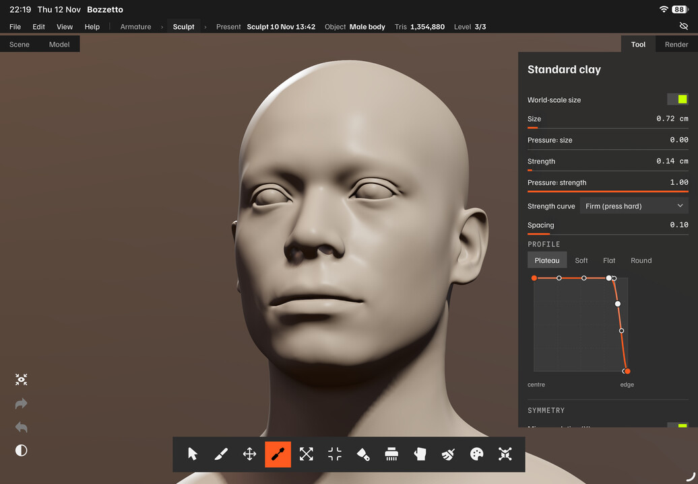
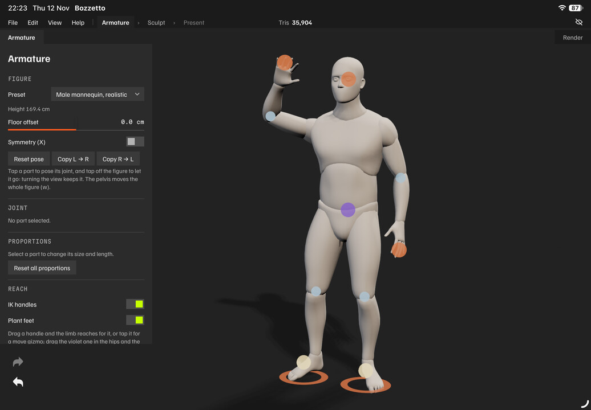
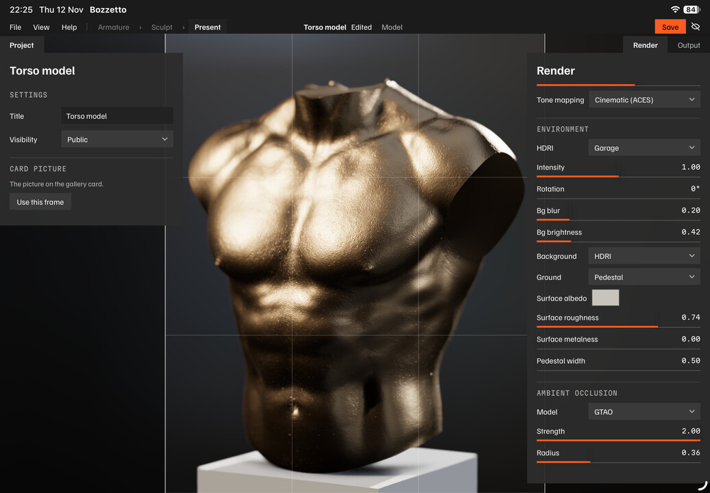

# Bozzetto

A *bozzetto* is the small clay study a sculptor makes before the real piece, where the rough form gets worked out.

Bozzetto is a studio in the browser to pose, sculpt and present. Set up a mannequin for reference or as the start of a figure, sculpt in clay with an Apple Pencil or a mouse, then light it, render it and publish it. The three workspaces follow that order: **Armature**, **Sculpt**, **Present**.

It installs to an iPad's home screen and works offline. Built as a study and teaching tool, and as a way to render out content. Shared under MIT for anyone who finds it useful.

**Live at [bozzetto.vidarrapp.se](https://bozzetto.vidarrapp.se)**

## Install as an app

Bozzetto installs to the home screen and opens fullscreen. That is the way to use it on an iPad. The gallery's **Install** button walks you through it.

- **iPad and iPhone (Safari):** Share button, **Add to Home Screen**, **Add**.
- **Android (Chrome):** the **⋮** menu, **Add to Home screen**, confirm.

Installed, it works offline: the app, the base meshes, the mannequins and the default lighting are all on the device. Updates download in the background and a notice says when one is ready.

Your work autosaves on your device. Nothing uploads unless you sign in and save or publish. There are no analytics and no ads. Deleting the app deletes the work kept on the device, so save a file or sign in for anything you want to keep.

## Armature

A posable figure, for reference or as the start of a sculpt. Pick **Create → New Armature** in the gallery. No sign-in needed.

- **Figures.** Four mannequins, male and female in realistic and stylized proportions, plus two block figures. You can also load your own rigged `.glb`.
- **Pose.** Tap a part to turn its joint, held within the joint's limits. Symmetry (`X`) mirrors the pose to the other side.
- **Reach.** Drag the ball at a hand, a foot or the head and the limb follows. Pin a ball to hold it in place while the rest of the figure moves. Smaller balls at the knees and elbows aim the bend.
- **Feet on the floor.** Feet stand flat on the floor and stay planted through a crouch or a lean.
- **Proportions.** Change the size and length of each part.
- **Send to Sculpt.** Turns the posed figure into one clay object and opens it in Sculpt.
- **Files.** The figure autosaves and shows as a card in the gallery. **File → Save** writes an `.armature` file.

## Sculpt

Pick **Create → New Sculpt** in the gallery. No sign-in needed, and nothing leaves your device unless you sign in and save or publish.

- **Brushes.** Ten on `1` to `0`: Crease, Move, Standard clay, Inflate, Pinch, Flatten, Rake, Drag, Polish and Paint. `Shift` smooths and `Alt` carves from any brush. Each brush keeps its own size and settings.
- **Pencil pressure.** Apple Pencil pressure drives the strength of the stroke. Strength is set in centimetres for the brushes that push the surface.
- **Profile curves.** Clay, Crease, Polish, Paint and the Rake's tines each have a falloff curve you can edit, with presets.
- **Masking.** Paint a mask with `Ctrl`, mask one side of an edge loop with `Ctrl`+`Shift`+drag, and extract a masked region as a new object.
- **Poly groups.** Split an object into coloured groups by mask, by angle or by piece. Show, hide and mask by group.
- **Topology.** Subdivision levels, dynamic topology, voxel remesh and quad remesh.
- **Symmetry.** Mirror across X, Y or Z, set per brush.
- **Painting.** Paint colour on the surface, flood fill, and set a material per object.
- **Objects.** Several objects in one scene, with a list to select, hide and lock them, a move, rotate and scale gizmo, and Duplicate, Mirror, Radial copies and Merge.
- **Create.** Primitives at real sizes and a library of base meshes: figures, heads, hands, feet and skulls.
- **Real sizes.** One unit is a centimetre, and the interface shows centimetres and millimetres.
- **Files.** Save and open `.bozz` scenes. Import and export OBJ, keeping the file's vertex order where it can.
- **Made for iPad.** Fingers orbit, pan and zoom. The Pencil sculpts. A resting palm is ignored.
- **Autosave.** Work in progress is kept on the device and shows in the gallery as an **In progress** card.

## Present

Light the piece, render it and publish it. Open **Present** from the path at the top of Sculpt, or with `Shift`+`P`.

- **Render.** Lights with soft shadows, environment lighting, ten matcaps, tone mapping, ambient occlusion, depth of field, ground and background.
- **Turntable.** A slow turn around the piece. `Space` starts and stops it.
- **Output.** **Save image** saves a PNG. **Record reel** saves a turntable or a timelapse as MP4 or GIF, with a choice of aspect.
- **Publish.** Signed in, publish the piece as a model. It opens for others at the camera and look you set, and the card picture is your view.
- **Frames.** A timelapse is a sequence of `.obj` or `.glb` files, one per stage. Add them on the **Frames** tab, name the stages, and set the playback speed.

## Gallery and viewer

- **Gallery.** The site's templates as cards, led by a **Create** tile with **New Sculpt**, **New Armature**, **Import OBJ** and **Create timelapse**. Your work in progress and the scenes kept on your device show here too.
- **Viewer.** A published model or timelapse plays as real geometry, not a video. Orbit it, relight it, change the material, and scrub a timelapse stage by stage.

## Accounts and Community

Sculpting and posing need no account. An account lets you keep work on the site and share it. Joining is by invite, and signing in uses a passkey or a code sent by email.

- **My projects.** Your saved scenes, models and timelapses, with your storage use. Open, rename, download or delete them.
- **Community.** Work that members share, newest first. Sort it, search by title or handle, and star what you like.
- **Sharing.** A model or timelapse in My projects has a **Share to Community** switch. Shared work is reviewed before it shows. It is to look at: there is nothing to download or copy.
- **Report.** **Report…** in the viewer sends a reviewer a report.
- **Account.** Change your handle and address, manage passkeys, see where you are signed in, download your data, or delete the account.

## Controls

Every key can be changed under **Edit → Preferences**. **Help → Hotkeys** (`H`) lists the keys as they are set. Double-click a slider to type a value.

### Everywhere

| Input | Action |
| --- | --- |
| Left drag, or one finger | Orbit |
| Middle drag, `Shift`+drag, or two fingers | Pan |
| Right drag, scroll, or pinch | Zoom |
| `F` / `A` | Frame the model / the whole scene |
| `Tab` | Hide and show the interface |
| `H` | Hotkeys |
| `Ctrl`+`Z` / `Ctrl`+`Shift`+`Z` | Undo / redo |

### Armature

| Input | Action |
| --- | --- |
| Tap a part | Select it and turn its joint |
| Drag a ball | Reach with that hand, foot or head |
| Drag a small ball | Aim that knee or elbow |
| Drag the ball in the hips | Move the whole figure |
| `X` | Symmetry on or off |
| `W` / `E` / `R` | Move the pelvis / rotate the selection / scale the selected part |
| `Shift`+`R` | Reset the pose |
| `Ctrl`+`Enter` | Send to Sculpt |

### Sculpt

| Input | Action |
| --- | --- |
| Drag on the model with the pen or mouse | Sculpt (`Alt` carves, `Shift` smooths) |
| `1` to `0` | Brushes |
| `B` / `S`, held while dragging | Brush size / strength |
| `X` | Symmetry for the current brush |
| `Ctrl`+drag | Paint a mask (`Alt` unmasks) |
| `Ctrl`+`Shift`+drag across the model | Mask one side of an edge loop |
| `Ctrl`+`A` / `C` / `I` / `E` | Mask all / clear / invert / extract |
| `Ctrl`+`G` | Masked faces into a new poly group |
| `Shift`+`F` | Poly group colours on or off |
| `Ctrl`+`Shift`+click | Show one poly group alone |
| `Q` | Select tool |
| `T`, or `W` / `E` / `R` | Transform gizmo, or move / rotate / scale alone |
| `Alt`+`Q` | Solo the active object |
| `Ctrl`+`D` | Subdivide |
| `Ctrl`+`M` / `Ctrl`+`J` | Mirror / merge the selected objects |
| `Shift`+`W` | Wireframe |
| `Shift`+`P` | Present |

### Present and the viewer

| Input | Action |
| --- | --- |
| `Space` | Play or pause (in Present, the turntable) |
| `←` / `→` | Step a frame |
| `1`, `2` to `9` | Lit, or a matcap |
| `Shift`+`S` | Shadows on or off |
| `G` | Cycle the ground |
| `L`, held while dragging | Move the key light |
| `Esc` | Leave Present |

## Changelog

### Unreleased

- **Pages in the new look.** My projects, Community, Account, Review and Owner tools share one navigation row and one footer. Lists are rows, galleries are cards, and delete is a trash icon.
- **Present is one workspace.** Creating a timelapse and editing a published project both happen in Present, which has a **Frames** tab for the files.
- **The viewer in the new frame.** A published piece opens under the same title strip as the workspaces, with the transport along the foot.
- **Sign-in window.** Email comes first, then **Use a passkey**, then **Email me a code**.
- **Stars.** A star is white when pressed and grey when not.
- **Card pictures fill their tile.** Gallery, Community and My projects cards are 4:5, the shape the pictures are taken at, so they no longer show bands at the sides.
- **Easier to read.** Placeholder text, hotkeys on a hovered menu row and red error text have more contrast. Red buttons are a deeper red with white labels.
- **Phone.** The title strip is taller on a phone and its menus no longer overlap the tabs under it.
- **Wireframe with ambient occlusion.** The wireframe no longer draws dark smudges and broken lines when ambient occlusion is on.
- **Hotkeys.** The Hotkeys button at the foot of the Render panel is gone. Use **Help → Hotkeys** or `H`.
- **Smaller download.** The app downloads about 0.7 MB less in fonts.

### v0.6.4

- **New interface.** The app has a dark grey, square look. Sculpt and Armature share a title strip with File, Edit, View and Help, and the paper theme is gone.
- **Three workspaces.** Armature, Sculpt and Present are workspaces with a path between them. Present has Render and Output tabs and a Publish button.
- **Help menu.** Help topics cover every tool and option, and About and credits lists what the app uses.
- **Rake and Clay.** The Rake stops at depth, with a Stop at depth option. Clay is gentler and follows the surface. Strength is now a length in centimetres.
- **Brush curves.** Brush falloffs are curves you draw in the Tool panel. The tine rake is a new brush, Smooth gains a Surface mode, and brush alphas are removed.
- **Poly groups.** Faces can be grouped, coloured with `Shift`+`F`, hidden and split into objects. Blender base meshes open with groups.
- **New masking and remesh.** `Ctrl`+`Shift` and a drag masks one side of an edge loop. The Model panel gains Quad remesh with a progress bar and Cancel.
- **Smaller changes.** Zoom goes toward the work, the last object can be deleted, and ambient occlusion stays on while you turn the model. Shadows after poly group colours are fixed.

### v0.6.3

- **Centimetres.** Sizes are real lengths in centimetres. Older scenes open as before, with a Set scale banner asking how tall the object really is.
- **Channel box.** The Tool panel shows Translate, Rotate and Scale values for the active object, which you can type into.
- **Community.** The gallery has a Community page with sort, search, stars, author pages, Share to Community from My projects, and Report.
- **Review.** The owner and moderators review shared work on a Review page with Queue, Reports, History and Gallery tabs.
- **OBJ.** Create gains Import OBJ, and an imported OBJ keeps its vertex and face order when exported. Create timelapse saves to My projects when signed in.
- **Real sizes.** Primitives and mannequins come at real sizes, and the floor is fixed, with a Floor offset control.
- **Armature and viewer.** Proportions move the joints, `R` scales a part, and only the key light casts a shadow by default. Hold `L` to move the key light in the viewer.
- **Other changes.** Solo moves to the brush rail and each account gets 500 MB. A pen barrel button no longer leaves the view turning, and the gallery scrolls in Firefox. Timelapse recording is removed from the web app.

### v1.4.2

- **Present mode.** A Present button and `Shift`+`P` show the model alone, with a turntable and Save image.
- **Save turntable.** Present can save the turntable as an MP4 or GIF, and `Space` starts and stops it.
- **Publishing from Present.** The published project keeps the camera and the whole look.
- **Gallery pictures.** Thumbnails are 4:5 portraits.
- **Shadows.** Shadows are sharper because they are fitted to the subject, and the rim light now casts its shadow.
- **Armature.** The clavicles now mirror with symmetry on.
- **In progress card.** Work already saved to the library no longer shows a separate In progress card.
- **Legal pages.** The terms and privacy notice are complete.

### v1.4.1

- **Armature selection.** A part stays selected while you orbit, pan or zoom, and tapping a hand, foot or head ball selects it.
- **Armature floor.** Figures stand on the floor and the floor no longer moves. Plant feet now shows a ring under each held foot.
- **Armature undo.** Undo and redo work as in Sculpt, with `Ctrl+Z` and `Ctrl+Shift+Z`, and the Armature panel docks on the left.
- **Armature projects.** Save to library keeps a figure as a project in My projects, which opens back in Armature mode.
- **Backdrop.** Sculpt and Armature start on a neutral grey backdrop.
- **Create.** The Create menu has three buttons: New Sculpt, New Armature and Upload Model(s).

### v1.4

- **Templates.** The gallery shows the site's templates. A scene template opens in Sculpt as a copy, and Save to library keeps it as your own.
- **Accounts.** You can sign in with a passkey or an emailed code and join by invite. Accounts stay off until the site's owner switches them on.
- **My projects.** It lists your work and storage, and lets you open, download, rename and delete projects. Save to library goes there when signed in.
- **Account.** Change your handle, address and passkeys, and see where you are signed in. Download my data zips everything the site keeps about you, and Delete account removes it.
- **Owner tools.** Owner tools gained Invites, Users and Audit tabs.
- **Colour.** A painted model gets a Sculpt colours or Plain colour switch. Drag a background or light swatch onto the view to pick a colour, in a larger picker.
- **Voxel grid.** The remesh grid is drawn while you hold the Resolution slider, and Resolution goes up to 512. A remesh too big for the device is refused with a message.
- **Passkey check.** A test page under Preferences, Diagnostics checks whether passkeys work on your device.

### v1.3.5

- **Scene links ask first.** Opening a scene by its link asks before it replaces the work on the device.
- **Bad files.** A damaged or oversized `.bozz` file is refused with a reason instead of crashing the tab. An autosave that cannot be read is set aside and Sculpt starts fresh.
- **Sign out.** Sign out forgets the sign-in and removes the device's copies of your private lists.
- **Safer sign-in.** The server verifies sign-ins more strictly and refuses writes from other sites.

### v1.3.4

- **Faster frames.** Sculpt and Armature keep ambient occlusion still under a stroke. Preferences, Performance offers Fast frames or Full look.
- **Smoother view.** Navigation follows your hand more closely at any frame rate, and edges are smoothed once the view is still. Anti-aliasing can be set to When still, Always or Off.
- **Adaptive quality.** The app lowers quality when frames run slow and restores it when they recover. Panels no longer blur the view, and Panel opacity is set under Preferences, Appearance.
- **Diagnostics.** The Frame meter, Stall log and Input log are in Preferences, Diagnostics.
- **Updates.** A notice says when the app is downloading or has installed an update. The hotkey guide shows the version and a Check for updates button.
- **Projects.** Save to library uploads a private project when signed in and downloads a `.bozz` file when signed out. Projects can be public or private. An expired sign-in is reported clearly, and the scene is kept as Not uploaded.
- **Interface.** Capture is a floating window. The Model panel docks on the left under Scene with Mask and Extract inside it. Double-click or double-tap a slider to type a value.
- **Look and Armature.** Environment intensity has a more usable scale and the HDRI background has Bg brightness. GTAO no longer draws black outlines. `L` moves the key light in Armature, and a reach past a joint's limits settles on the nearest allowed pose.

### v1.3.3

- **Negative on a tap.** A tap on Negative carves the next stroke, and a long press latches carving on.
- **Arrow keys.** `↑` and `↓` walk the Scene list, and `Shift` extends the selection.
- **Brush sizes.** Every brush keeps its own size.
- **Autosave.** The autosave writes at most once a minute, which helps iPad freezes.
- **Timelapse capture.** Capture starts off for everyone until you tick Record timelapse.
- **Fix.** The World-scale box in the Tool panel now follows an opened scene.

### v1.3.2

- **Fingers navigate.** In every tool one finger orbits and two pan and zoom. The Pencil and mouse sculpt. Preferences has a Fingers sculpt too option.
- **iPad long press.** A long press on the canvas, toolbar or panels no longer triggers Safari actions or cancels the touch.
- **Zoom.** You can zoom much closer to the model, and zooming back out always works.
- **Move.** A Move stroke now starts on the model surface like other brushes.

### v1.3.1

- **Solo.** `Alt`+`Q` shows the active object alone in Sculpt.
- **Hip ball.** A violet ball in the hips of the Armature figure moves the whole figure.
- **Necks.** The mannequins' necks turn higher up.
- **Fix.** Undoing an add while another object is active no longer leaves the object drawn.

### v1.3

- **Armature for everyone.** The Create tile starts a new sculpt or armature for every visitor, and an armature in progress shows as a card.
- **Offline.** The base meshes, mannequins and default environment work offline from the first visit.
- **Default figure.** A new armature starts on the realistic male mannequin.
- **Mannequin fixes.** Mirrored right limbs no longer render inside out, the hips sit lower, the deltoid moves with the arm, and knees and elbows bend the right way.
- **Hips and joints.** The hips open outward and the head reaches through the spine.
- **Feet.** Both feet start pinned, and Plant feet keeps a foot on the ground flat. Pinned feet no longer snap round when the pelvis moves.
- **Armature defaults.** Symmetry starts off, and the balls win the click over nearby parts.
- **Gallery card.** The armature's gallery card has a picture of the figure.

### v1.2

- **Base meshes.** The Create menu offers Blender Studio's Human Base Meshes, including figures, heads, hands, feet, eyes, jaws and skulls.
- **Primitives.** Cone, capsule and an upright plane are new.
- **Mannequins.** Armature mode has male and female, realistic and stylized mannequins beside the blocks.
- **Wireframe.** The wireframe overlay draws quads as quads.
- **Clay.** Clay takes two photographed stencils, Thumbed and Cracked.
- **Offline.** The UI fonts work offline.

### v1.1

- **Sculpt mode (alpha).** Bozzetto can now sculpt, with ten brushes, pen pressure, 64-deep undo, masking, Extract and mirror symmetry.
- **Brushes.** Rake, Polish and Crease with Profile and Pinch sliders were added.
- **Topology.** Multiresolution, dynamic topology and voxel remesh are available.
- **Paint.** Vertex painting, named materials and an HSV colour picker are included.
- **Objects.** A transform gizmo on `W`, `E` and `R`, a multi-object outliner, a Select tool, and mirror and radial copies.
- **Hotkeys.** Every hotkey is editable under Edit, Preferences.
- **Files.** A File menu handles new, open, save, save to library, and OBJ import and export, with `.bozz` scene files.
- **Other.** Ten new matcaps, selectable tone mapping, timelapse capture, iPad support and autosave with an In progress gallery card.

### v1.01

- **Smaller frames.** Timelapse frames are about 3 to 4 times smaller.
- **Playback.** A loaded-frames bar and a buffering indicator were added.
- **Depth of field.** Double-click the model to set the focus.
- **Fixes.** Loading messages are clearer, and wireframe opacity and staging in unlit modes were fixed.

### v1.0

- **First public release.** It has a WebGPU renderer with a WebGL 2 fallback.
- **Timelapses.** Sculpt timelapses stream as real per-frame geometry.
- **Lighting.** A three-point rig, soft shadows and HDRI environment lighting.
- **Rendering.** Ambient occlusion and depth of field.
- **Staging.** A studio floor and pedestal.
- **Editor.** An in-browser editor exports a self-contained `.html`, plus MP4 and GIF reels.
- **Gallery.** The gallery shows portrait thumbnails.

## Source

The code is on [GitHub](https://github.com/vidarrapp/bozzetto) under the MIT
licence, and the app can be built and run from it; [`docs/`](docs/) has the
notes for that.

## Credits

- Sculpt mode is built on [SculptGL](https://github.com/stephomi/sculptgl)'s editing core, MIT, by Stephane GINIER. The vendored source and its license live in `src/sculpt/vendor/`.
- Quad remesh is [QuadriFlow](https://github.com/hjwdzh/QuadriFlow), BSD-3, by Jingwei Huang, Yichao Zhou, Matthias Niessner, Jonathan Shewchuk and Leonidas Guibas, compiled to WebAssembly by `tools/quadriflow-wasm/build.sh`, with LEMON, pcg32, Eigen and the Boost Graph Library compiled in; their licences are in `THIRD_PARTY_NOTICES.md`.
- Toolbar icons: [Uicons by Flaticon](https://www.flaticon.com/uicons).
- The base-mesh library is Blender Studio's [Human Base Meshes bundle](https://www.blender.org/download/demo-files/#asset-bundles) v1.4.1, CC0, by Dan Ulrich, Julien Kaspar, Paul Kotelevets and Tonatiuh de San Julián. Exported by `tools/export-basemeshes.py`; see `public/assets/basemeshes/LICENSE.txt`.
- The mannequins are the same bundle's primitive figures, by Paul Kotelevets and Julien Kaspar, rigged onto Bozzetto's bones by `tools/build-mannequins.py`; see `public/assets/armature/LICENSE.txt`.

## License

MIT. See [LICENSE](LICENSE).
